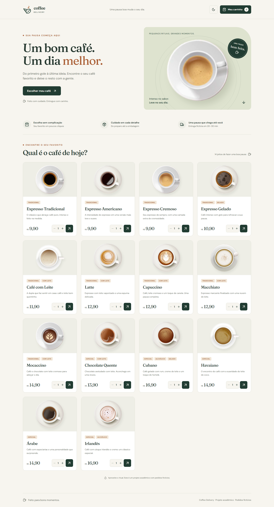

# Coffee Delivery

Uma boa pausa começa com um bom café. SPA acadêmica de e-commerce com identidade própria, catálogo de 14 cafés, carrinho persistente, endereço com consulta de CEP, pagamento informativo e confirmação de pedido fictício.

**[Repositório público](https://github.com/yukioarthur/coffee-delivery)** · **[Aplicação](https://coffee-delivery-artyu-spa.hollowbarge33.chatgpt.site)** · [Estado da entrega](docs/DELIVERY.md)



## Executar

Requer Node.js 22.12+ (ou versão LTS compatível com Vite 7) e npm. Não requer chave, conta, .env, backend ou banco de dados.

```bash
npm ci
npm run dev
```

| Script | Finalidade |
|---|---|
| `npm run dev` | Desenvolvimento local |
| `npm run build` | TypeScript estrito + build estático em dist |
| `npm run preview` | Conferir o build localmente |
| `npm test` | 43 testes de lógica, validação, pedido e consulta CEP |
| `npm run test:e2e` | 8 testes de navegador; gera screenshots e vídeos |

Antes do primeiro E2E, instalar o navegador com `npx playwright install chromium`. Os testes iniciam a aplicação automaticamente na porta 4173. Em um ambiente com Chromium já instalado, `PLAYWRIGHT_CHROMIUM_EXECUTABLE_PATH` permite informar o executável; não é necessário no uso normal. A consulta ViaCEP é interceptada nos E2E para resultados reproduzíveis e dados fictícios.

## Fluxo e regras

1. Escolha a quantidade e adicione cafés na Home (`/`). Repetir o produto acumula unidades na mesma linha.
2. Abra o carrinho (`/checkout`), ajuste quantidades ou remova produtos. O badge soma unidades.
3. Informe um CEP. Ao sair do campo, a aplicação consulta ViaCEP e preenche rua, bairro, cidade e UF disponíveis. Confira os dados e preencha número e complemento opcional. Os campos continuam editáveis.
4. Selecione crédito, débito ou dinheiro e confirme. O pagamento é apenas informativo, na entrega.
5. Veja endereço, pagamento, prazo ilustrativo e resumo em `/success`. O carrinho é limpo e a confirmação fica na sessão.

Quantidades: 1–99 por produto, com redução bloqueada em 1 e remoção explícita. Frete fixo fictício de R$ 3,50. Cálculos em centavos, apresentação em BRL. Sem itens, subtotal/frete/total são zero. CEP não encontrado precisa ser corrigido; falha do serviço oferece nova tentativa ou preenchimento manual. Consulta em andamento bloqueia confirmação. Respostas antigas são canceladas ao mudar o CEP. Nenhuma cobrança ou entrega real é realizada.

## Tecnologias e decisões

React 19, Vite 7, TypeScript, React Router, React Hook Form, Zod, styled-components, Lucide, Vitest e Playwright. As versões exatas ficam no package-lock.json.

Arquitetura por feature: `catalog`, `cart`, `checkout`, `success`. `components/ui` reúne controles e ações reutilizáveis; `layouts` reúne Header, Footer e tema. Props conectam catálogo e ação de compra. CartProvider compartilha o estado; useReducer aplica ações imutáveis; useState controla quantidades provisórias e tema; useEffect persiste e limpa efeitos; useCart/useTheme/useCepLookup isolam responsabilidades.

O LocalStorage guarda apenas carrinho e tema. Valores armazenados são sanitizados e os preços vêm do catálogo local. Endereço/pagamento ficam no formulário e no snapshot em SessionStorage, sem histórico. O snapshot evita que esvaziar o carrinho destrua a confirmação. Storage bloqueado não derruba a aplicação e gera aviso. O tema respeita a preferência do sistema na primeira visita e a escolha salva nas seguintes.

Styled-components define o estilo compartilhado de ações (Button, ActionLink e AnchorButton). CSS local organiza os layouts de cada feature e tokens semânticos controlam os dois temas. Essa composição mantém os estilos próximos aos domínios e atende à stack prevista no escopo.

ViaCEP é a única integração externa da aplicação. Ela recebe somente o CEP digitado, não o endereço completo nem o número. Fontes são servidas localmente. Não há autenticação, banco, API própria, pagamento real, busca, filtros, cupons ou telas adicionais.

## Documentação SDD

| Documento exigido | Fonte canônica / conteúdo |
|---|---|
| [PRD_SPEC](docs/PRD_SPEC.md) | [01-prd](docs/01-prd.md): fontes, RF-01–16, RN-01–10, escopo e aceite |
| [TECH_SPEC](docs/TECH_SPEC.md) | [02-tech-ux-spec](docs/02-tech-ux-spec.md): arquitetura, tipos, estados, design e testes |
| [TASKS_SPEC](docs/TASKS_SPEC.md) | Checklist e [tarefas atômicas](docs/tasks/) |
| [AGENTS](AGENTS.md) | Diretrizes de atuação e limites do assistente |
| [AI_USAGE](docs/AI_USAGE.md) | Três evidências principais, prompts, decisões e revisão |

As especificações precederam a primeira implementação local. O acesso completo ao Notion só funcionou depois pelo navegador; a revisão incorporou a consulta obrigatória de CEP, styled-components e a rota `/success` antes da publicação. O Git remoto foi criado após os primeiros testes locais; o histórico não pretende simular commits anteriores à sua criação.

## Branding com IA


Conceito: um grão de café com asa e vapor une ritual e entrega. Marca criada com a ferramenta de geração de imagens integrada ao Codex; não foi copiada a logo do protótipo. Verde profundo, creme e caramelo; Fraunces nos títulos e DM Sans no corpo. No fundo escuro, a marca recebe apoio claro para preservar a legibilidade; o favicon usa o mesmo símbolo. Fotos dos 14 cafés foram extraídas do SVG fornecido pelo usuário. Todos os ícones funcionais são Lucide.

Prompt completo, resultado e curadoria estão na [evidência de branding](docs/evidence/ai-02-branding.md). O símbolo foi gerado para este projeto, sem referência a uma marca comercial específica. Não se afirma exclusividade jurídica de uma imagem gerada; a curadoria humana e a revisão dos termos da ferramenta continuam sob responsabilidade do autor. As fotos da referência conservam os direitos de seus autores; esta entrega não atribui uma licença geral a esses materiais.

## Evidências visuais e demonstração

| Tela | Desktop | Tablet | Mobile | Dark mobile |
|---|---|---|---|---|
| Home | [1440px](docs/evidence/home-desktop.png) | [768px](docs/evidence/home-tablet.png) | [390px](docs/evidence/home-mobile.png) | [390px](docs/evidence/home-dark-mobile.png) |
| Checkout | [1440px](docs/evidence/checkout-desktop.png) | [768px](docs/evidence/checkout-tablet.png) | [390px](docs/evidence/checkout-mobile.png) | [390px](docs/evidence/checkout-dark-mobile.png) |
| Sucesso | [1440px](docs/evidence/sucesso-desktop.png) | Layout em coluna validado no fluxo | [390px](docs/evidence/sucesso-mobile.png) | [390px](docs/evidence/sucesso-dark-mobile.png) |

Também há capturas de [Home](docs/evidence/home-320-dark.png), [Checkout](docs/evidence/checkout-320-dark.png) e [Sucesso](docs/evidence/sucesso-320.png) em 320px. A resposta CEP e os endereços nas capturas são dados fictícios de teste.

**[Vídeo curto do fluxo completo](docs/evidence/demo-compra.webm)** · [Roteiro de demonstração](docs/DEMO.md) · [Relatório de verificação](docs/evidence/verification.md)

Os testes cobrem operações do reducer, limites, reidratação inválida, cálculos, schema, snapshot, CEP, fluxo completo, refresh, remoção, carrinho vazio, tema persistente, foco, storage bloqueado, falha de API e cancelamento de consulta antiga. Há validação de imagens carregadas, ausência de overflow e erros de execução no fluxo principal. Não se afirma uma auditoria completa de WCAG, compatibilidade em todos os navegadores ou testes com tecnologias assistivas reais.

## Publicação

Build estático em `dist`. Há configuração de fallback SPA para Vercel (`vercel.json`) e Netlify (`netlify.toml`). O mesmo código pode ser publicado nessas plataformas usando build `npm run build` e pasta `dist`. A publicação desta entrega usa Sites, plataforma equivalente; audiência e estado efetivos estão em [DELIVERY](docs/DELIVERY.md).

Não versionar node_modules, dist, .env reais, tokens ou resultados temporários. O identificador de hosting em `.openai/hosting.json` não contém credenciais.

## Referências

- [Escopo completo no Notion](https://deluxe-blue-bc1.notion.site/Projeto-Final-05-Coffee-Delivery-React-TypeScript-IA-41bdfca74d8d8119a849e30ea492a6af)
- [Figma fornecido](https://www.figma.com/design/yGPNTA0Yczb183EikXGIiA/Coffee-Delivery-%E2%80%A2-Projeto-Final-React?node-id=2-1297)
- [ViaCEP — contrato e erros](https://viacep.com.br/)
- [Styled-components — componentes e estilos compartilhados](https://styled-components.com/docs/basics)

O aluno deve revisar e explicar as decisões. Este repositório registra apoio de IA e resultados observados, sem atribuir revisões humanas que não ocorreram.
